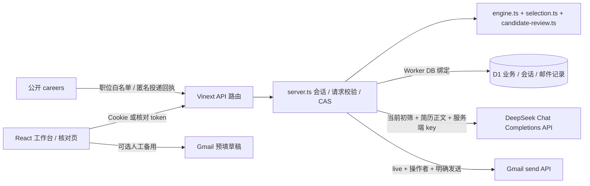

# 工程架构与核心模块

本组文档记录已落盘核心业务、公开自助投递、Gmail OAuth、面试邀请答复与DeepSeek复筛合同。历史82项/41组HTTP及切换提供商前196项结果均不是当前全量结论；最终测试、配置及真实外部验收统一记入 [VERIFICATION.md](../VERIFICATION.md)。不能把mock称为真实提供商调用通过。

拾才 TalentFlow 是社招、校招共用的招聘协作 Demo。核心对象是「一次投递」，同一候选人可以对应多个职位，每次投递独立保留资料快照、甄选、面试、录用与入职结果。默认种子包含 8 个职位、36 名合成人员和 42 次投递（`lib/seed.ts`）。

当前Sites站点为public。内部登录/招聘读写在live或配置非空`DEEPSEEK_API_KEY`时先核对允许的Sites真实操作者，再核对应用角色；未启用时保留合成Demo会话。公开例外有`/api/careers`的开放职位/匿名投递、两类token核对/面试答复，均不返回内部state。公开入口不获得HR权限，也不调用收费模型或自动发信；完整生产身份与资料治理仍未完成。

## 六个核心模块

| 核心模块 | 已实现的工作与业务规则 | 主要实现 | 现有验证入口 |
| --- | --- | --- | --- |
| 职位需求确认 | HR 建立社招/校招需求，校招必须有批次和届别；负责经理审批后开放；有活动投递不能关闭职位 | `lib/engine.ts` 的 `createJob`、`jobStatus`；`Workspace.tsx` | `tests/engine.test.ts` 的职位审批、活动投递关闭用例；`scripts/api-smoke.mjs` |
| 候选人与独立投递、简历核对 | PDF/DOCX/TXT本地解析；HR明确关联已有主档；公开careers匿名投递只建独立主档，严格白名单/同意/请求幂等；自动条件初筛，仅排入AI待处理；投递快照独立；7天核对、更正使旧决定失效 | `lib/careers.ts`、`lib/resume-file.ts`、`lib/resume-parser.ts`、核对/Gmail模块；`lib/engine.ts` | 文件/公开投递/核对/回执测试及五组HTTP入口；真实收件另验 |
| 甄选与测评 | 新投递自动做条件初筛；有当前规则报告及简历正文时请求真实模型复筛，未知/差异保留待核实，失败/未配置明确保存；报告引用原文、无能力分；当前报告与 HR 通过贯穿面试、经理录用及 Offer；更正/重跑使旧决定失效；可选测评锁定答卷 | `lib/selection.ts`、`lib/resume-ai.ts`、`lib/resume-workflow.ts`；`lib/engine.ts#screeningApproved` | 甄选/引文/脱敏/模型错误/迟到结果单测；提供商为 mock，真实模型尚未验收 |
| 面试协作 | 排期/改期/资源冲突与手动会议资料；HR预览后明确向候选人主档邮箱发邀请；独立答复确认/申请改期；改期撤销旧链接；邮件与答复双状态；独立盲评/锁定/本人辅助 | `lib/engine.ts`、`lib/interview.ts`、`lib/interview-invitation.ts`、`lib/server.ts`；`projectState` | 会议、邀请业务/服务端编排/生命周期测试；[interview-invitations.md](./interview-invitations.md)；mock不证明真实建会/送达 |
| 录用与入职 | 负责经理确认录用；HR 发 Offer 前收齐已完成面试评价并处理待面试；接受 Offer、协议登记、实际入职分别保存；校招入职需协议签署或豁免；社招无该门槛 | `lib/engine.ts` 的 `decision`、`sendOffer`、`offerResponse`、`agreement`、`join` | `tests/engine.test.ts` 的完整入职、到期、社招/校招协议用例；`scripts/api-smoke.mjs` |
| 统计、权限与审计底座 | 基于同一投递 cohort 和阶段事件计算漏斗，区分人数与投递数；服务端按角色/资源投影；写入做 revision 冲突检查；投递操作留时间线；合成资料匿名清理 | `lib/metrics.ts`、`lib/server.ts`、`lib/engine.ts`、`db/schema.ts` | `tests/metrics.test.ts`、权限/冲突/匿名化单测及 HTTP 烟测 |

测试证明的范围、运行记录和缺口详见 [tests.md](./tests.md)。表中列的是仓库已有验证入口，不代表全部生产验收已完成。

## 技术与数据路径

- React 19、TypeScript、Tailwind，使用 Vinext 运行 Next.js 风格路由；Cloudflare Worker 承载服务端，D1 承载持久化。版本和命令以 `package.json`、`package-lock.json` 为准。
- MySQL/Redis位于独立`database-source`的本机开发范围，不纳入本次Sites包；线上本版仍使用D1。
- `db/schema.ts` / 首次迁移定义 `recruitment_state` 与 `sessions`；前者保存 `main` 行 JSON 集合及 revision，后者保存会话哈希。`lib/gmail.ts#tables` 按需建立 `mail_settings`、`oauth_states`、`mail_jobs`，分别存加密授权、一次 OAuth 状态、幂等发信回执。没有 RLS，均依靠服务端权限。
- 内部修改先查身份及`expectedRevision`，再克隆执行并以D1 revision CAS提交。公开careers不接收内部revision，使用UUID+规范化内容哈希幂等，CAS冲突重读重算最多3次；不覆盖并发数据。所有对象仍共用全局revision，不是逐实体事务/生产关系模型。
- 投递自己的 `version` 与时间线用于业务变化展示；候选人核对另有 `expectedVersion`，并比较签发时主档及投递字段。最终数据库提交仍经过同一个 CAS。
- AI 请求先保存投递和待处理状态，再请求模型；回写比对投递快照、岗位政策/说明和请求时间，旧结果丢弃。Gmail 先以邀请 ID 原子占用 `mail_jobs`，业务 JSON 与发信回执不在同一事务；读取招聘快照时会核对本地回执并用 CAS 修正摘要，不能据请求超时自动重发。
- 公开新投递也建立当前规则报告和`selection`，未知/差异只作为关注项；匿名提交仅保存AI pending，不调用模型。授权HR后续`ensure_resume_review`才能请求模型，且仍须当前报告、HR人工通过、经理等后续门禁；不能将新投递当作V1绕过。
- 简历原文件留在浏览器解析，保存的是用户确认后的文字和字段；未实现原文件存储、附件下载或 OCR。D1 状态序列化上限为 1,900,000 字节；简历/CSV/请求还有各自上限，见 [variables.md](./variables.md)。

## 身份与信任边界

1. `POST /api/session` 与 `getUser` 在live或启用真实模型时先调用`requireRecruitmentOperator`：要求Sites认证用户ID/邮箱匹配服务端配置；无AI key且非live才保持公开Demo。之后建立12h应用角色会话，256位Cookie的SHA-256存D1，不接受客户端角色。
2. `/api/recruitment` 必须有应用会话；写入由 `applyAction` 再检查角色、岗位/面试资源范围及业务门禁，响应由 `projectState` 裁剪。浏览器不拥有 D1 绑定，也不直接读取完整 JSON 状态。
3. 核对签发/撤销和面试邀请预览/发送/撤销要求HR；真发另需live操作者及Gmail授权。公开核对/面试答复仅凭各自token，分别返回本人白名单或单场必要日程，不返回HR资料/其它投递。完整token集合不进入内部投影，面试邮件摘要仅HR可见。
4. 公开careers无需操作者/会话，GET仅开放职位字段，POST只接受本次新资料并返回参考号/职位名/时间；未验证联系方式不能关联/读取私有主档，同岗重复给通用冲突。`careerSubmissions`元数据对所有内部投影也删除。两类token则只授权对应资料/单场答复。
5. 普通写入`checkOrigin`拒绝显式不匹配Origin；内部仍需身份，公开careers继续做严格字段/同意/幂等校验。Gmail另检查固定来源，OAuth用一次state/Cookie/操作者绑定。托管身份头依赖Sites入口清除伪造值并注入认证结果；本地`TEST_SITE_USER_ID/EMAIL`仅模拟该边界，不证明线上注入通过。

详细运行顺序见 [flows.md](./flows.md)，静态角色矩阵见 [permissions.md](./permissions.md)。

## 自动化、外部服务与公开页面

- 条件初筛、笔试、工作偏好、文本面试及本人评价辅助仍是明确标注的固定规则。简历复筛已新增 DeepSeek Chat Completions API 路径，严格结构和逐字引文校验，不设分数、不自动晋级；未配置 key 就记录失败，不生成假报告。详见 [automation.md](./automation.md)。
- AI 工作在请求内执行；批量多条仅保存待处理，选中详情时再请求。没有独立后台消费者、定时调度或自动 Offer 过期写入；无 `cron.md`。
- 核对邀请默认 API 预览；显式 `sendEmail=true` 要求 live、真实操作者和已授权 Gmail。`sent` 必须有 Gmail 消息 ID，只代表提供商接受，不能代表送达/已读。OAuth、加密、幂等与未知状态见 [GMAIL-INTEGRATION.md](./GMAIL-INTEGRATION.md)。
- 面试邀请复用Gmail：HR先预览再明确发送，只发候选人当前主档邮箱；会议资料和fragment答复链接随正文分发，最长7天且面试开始截止；排期/邮箱变化、投递关闭撤销旧链接，申请不自动改期。见 [interview-invitations.md](./interview-invitations.md)。Offer、短信、日历、渠道、电子签、HRIS未接入该外部路径；模板CONNECTORS与直接Gmail OAuth不同。

公开页面的元数据范围如下，未单列 SEO 文档：

| 路由 | 元数据与索引规则 | 可进入公开 HTML/预览的数据 |
| --- | --- | --- |
| `/` | `app/layout.tsx` 固定标题、描述和 favicon；没有候选人动态分享卡或 bot 分流 | 固定产品说明；招聘资料由会话 API 获取 |
| `/careers` | 固定招聘标题/描述，`noindex/nofollow` | 公开API仅返回开放职位白名单；不含负责用户、私有筛选政策、投递或候选人资料 |
| `/candidate-review` | 独立固定标题，`noindex/nofollow`、`no-referrer`；核对 API `no-store` | 页面 shell；本人资料只由 token API 获取，不写入动态 metadata |
| `/interview-response` | 固定标题、`noindex/nofollow`、`no-referrer`；初始token在fragment | 单场日程/会议资料由token API读取；API请求仍携token，需控制日志 |
| `/mail-connect` | 固定标题，`noindex/nofollow`、`no-referrer` | 授权状态仅对允许操作者提供发件邮箱，页面不收集密钥或 token |

## 已知限制与运行交接

| 限制/假设 | 代码依据及影响 |
| --- | --- |
| 公开共享演示身份 | 预览模式的 `Workspace.tsx`/`DEMO_USERS`；live 增加真实操作者门槛，但未实现真实员工角色/租户体系 |
| 单行文档库与全局 revision | `saveState` 的大小限制和 CAS；并发写不同对象也可能冲突，没有容量/负载承诺 |
| 审计是业务时间线 | `state.events` 与业务状态存于同一 JSON；HR 可重置样本、匿名化会清理备注，没有不可篡改归档或独立运维审计 |
| 联系方式脱敏依赖文本规则 | `projectState`/`redactText`；已覆盖字段及规则形式需测试，无法保证任意自然语言都能自动去标识 |
| 候选人核对令牌经 URL 和草稿分发 | `CandidateReview.tsx`、`CandidateReviewInvite.tsx`；页面/接口禁止 referrer 和缓存，提交后移除 URL token，但历史、提供商草稿和托管日志的清理仍需生产方案 |
| 外部副作用与本地写入分离 | Gmail `mail_jobs` 与 JSON CAS、模型请求与结果绑定；网络失败不能推断未发送，资料变化不能接收旧模型报告；见专项文档 |
| API key 与真实操作者共同启用 | `requireRecruitmentOperator` 在live或配置AI key时要求真实操作者，再应用角色；该代码守卫不替代Sites入口对身份头来源的保证，需托管集成验收 |
| 公开匿名资料未经身份核实 | `careers.ts`故意不按联系方式复用私有主档；同岗通用冲突、跨岗独立档案；没有邮箱所有权验证或全局反滥用限制，不可等同于真实身份确认 |
| 缺少生产运维能力 | 仓库未配置集中监控告警、备份恢复演练、生产 SSO 或限流；不能把一次构建或单测通过当成这些能力已验证 |

本地启动、迁移和发布入口沿用 [README](../README.md)。先安装依赖和构建，再对新建本地库执行迁移一次；运行中的服务可执行 HTTP 烟测。`reset` 会替换共享业务数据，迁移、测试和重置应针对可丢弃的合成库；不要重复对已有库执行首次建表。当前未提供自动备份/恢复工具。

## Related Documents

- [flows.md](./flows.md)：跨 UI、API、数据与 Gmail 草稿的受保护流程。
- [permissions.md](./permissions.md)：角色、资源范围、拒绝规则与数据投影。
- [variables.md](./variables.md)：配置、凭据、数据容量和上线前差距。
- [tests.md](./tests.md)：现有覆盖、建议测试和未验证规则。
- [GMAIL-INTEGRATION.md](./GMAIL-INTEGRATION.md)：Gmail OAuth、模板、回执与失败处理。
- [interview-invitations.md](./interview-invitations.md)：面试邮件与候选人答复双状态、生命周期及专项验收。
- [careers-handoff.md](./careers-handoff.md)：公开自助投递、主档隔离及原checkout验收范围。
- [automation.md](./automation.md)：自动初筛、真实模型输入/输出合同及硬门禁。
- [PLAN-V2.md](./PLAN-V2.md)：产品范围和验收合同；[VERIFICATION.md](../VERIFICATION.md)：实际执行记录。
